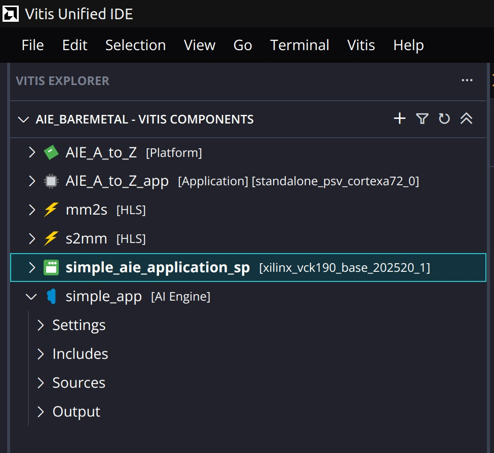

# 01. Overview

## Goal
Build and run a complete AI Engine system on a Versal VCK190 target, without Linux (bare-metal), and learn each stage of the flow: AI Engine design, PL kernels, system linking, packaging, simulation and emulation.

## The three parts of an AI Engine system

1. **AI Engine graph (AIE)**: the compute. C++ kernels placed on AI Engine tiles and connected into a graph (`simple_app`).
2. **PL kernels (HLS)**: data movers in programmable logic. `mm2s` pushes data from DDR into the AI Engine; `s2mm` pulls results back to DDR.
3. **PS application**: bare-metal code on the Cortex-A72 (`AIE_A_to_Z_app`) that configures and starts everything and checks the result.

## Flow followed

```
Platform (sample, VCK190)
   -> AI Engine component: build graph (aiecompiler)
   -> HLS components: mm2s, s2mm (C synthesis, package to .xo)
   -> System project: add components, create binary_container_1, link (v++)
   -> package.cfg: add bare-metal ELF, package (BOOT.BIN, xclbin, sd_card)
   -> AIE simulation (check the graph on its own)
   -> Hardware emulation (QEMU + PL simulation, run the full system)
   -> Read the reports
```

## What is different in my run
I skipped the optional Vivado step that creates a custom platform and used the sample platform `xilinx_vck190_base_202520_1` instead. Everything after that follows the tutorial.



*The workspace `aie_baremetal`: platform, application, two HLS kernels, system project and AI Engine component.*
