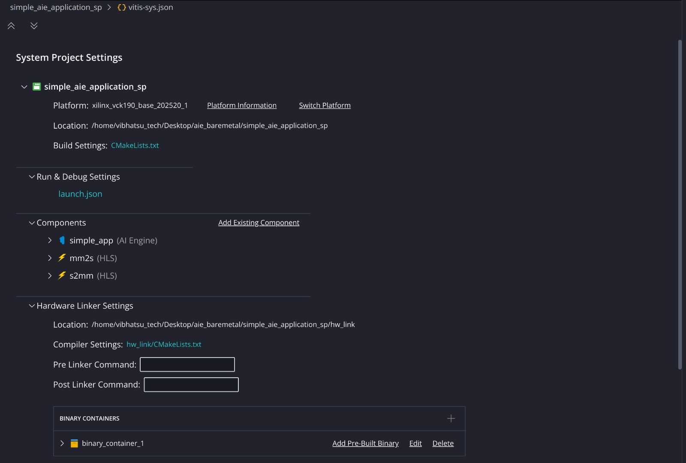
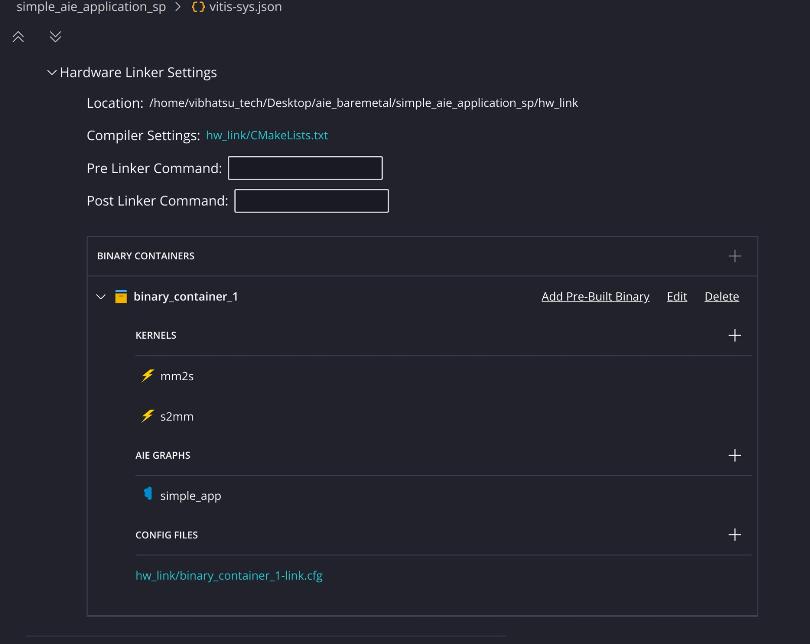

# 06. System Project, Linking and Packaging

## System project
`simple_aie_application_sp` targets platform `xilinx_vck190_base_202520_1`. Its settings file is `vitis-sys.json`.

The page lists: platform, location, build settings (`CMakeLists.txt`), run and debug settings (`launch.json`), the three components (`simple_app`, `mm2s`, `s2mm`) and the **Hardware Linker Settings**.

## Binary container
A **binary container** is the unit that is linked into one `.xclbin` file.

`binary_container_1` holds:
- **Kernels**: `mm2s`, `s2mm`
- **AIE graphs**: `simple_app`
- **Config file**: `hw_link/binary_container_1-link.cfg`, which tells the linker how the kernels connect to the graph (stream connections between the HLS kernels and the AI Engine PLIO ports).

## Linking
`v++ --link` combines the platform, the PL kernels and the compiled AI Engine graph. It drives Vivado to build the PL part and produces the `.xclbin`. In the Flow panel it appears as **LINK - binary_container_1**.

Link reports (Summary, System Guidance, Utilization, Timing Summary, Vivado Automation Summary) are covered in [doc 09](09_results_and_discussion.md).

## Packaging
**PACKAGE** builds the boot image. In `package.cfg` the bare-metal executable `AIE_A_to_Z_app.elf` is added so it runs on the A72. The packaged output (`package/sd_card`) contains `BOOT.BIN`, `boot.scr`, `Image`, and `binary_container_1.xclbin`. Hardware emulation also adds `launch_hw_emu.sh`, `qemu_args.txt`, `pmc_args.txt` and `sd_card.img`.

## Build All
**Build All** runs the whole chain (build components, link, package) in one go.
