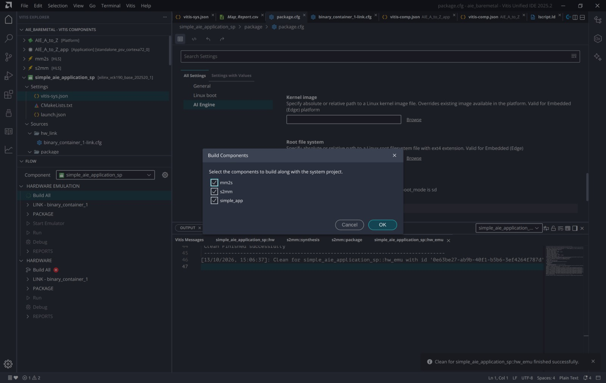

# 08. Hardware Emulation

## What it is
Hardware emulation runs the **whole system without a board**. The PS is emulated with **QEMU**, and the PL and AI Engine run in simulators. It is slower than hardware but much faster than debugging on a board, and it exercises the real boot image and the real bare-metal application.

## Steps in the Flow panel
Under **HARDWARE EMULATION** for `simple_aie_application_sp`:

1. **Build All**: builds `mm2s`, `s2mm`, `simple_app`, then links and packages.
2. **LINK - binary_container_1**
3. **PACKAGE**
4. **Start Emulator**
5. **Run**

The dialog asks which components to build along with the system project. All three (`mm2s`, `s2mm`, `simple_app`) are ticked. The Output panel shows a clean of the `hw_emu` target finishing successfully before a fresh build.

## Boot log
After **Start Emulator**, the console shows the simulator starting and QEMU waiting for connections, then the Versal boot sequence.

How to read it is in [doc 09](09_results_and_discussion.md).
