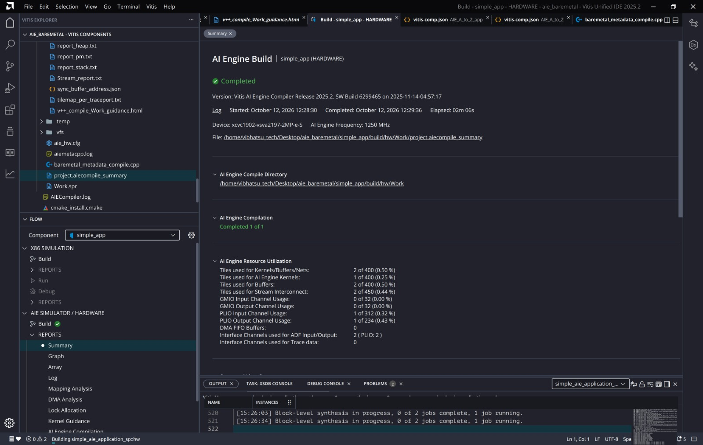
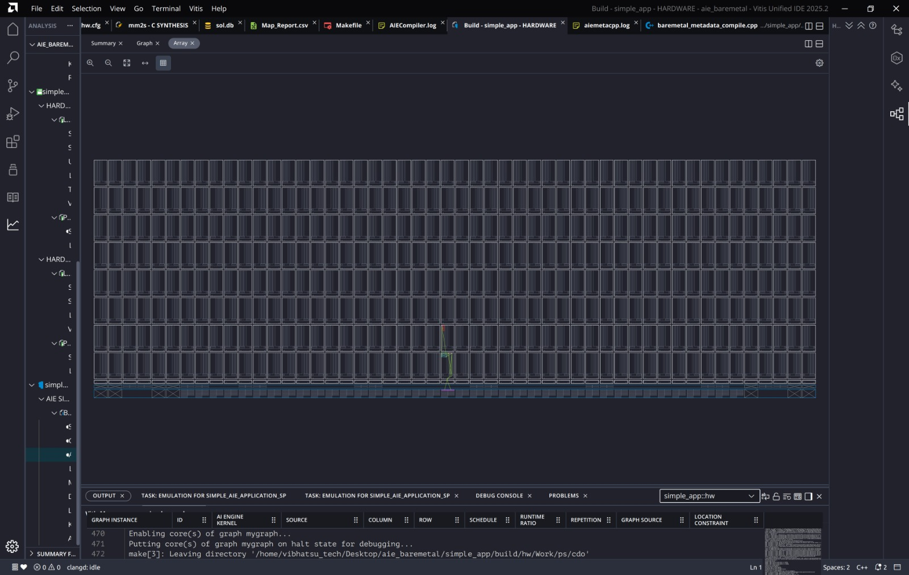
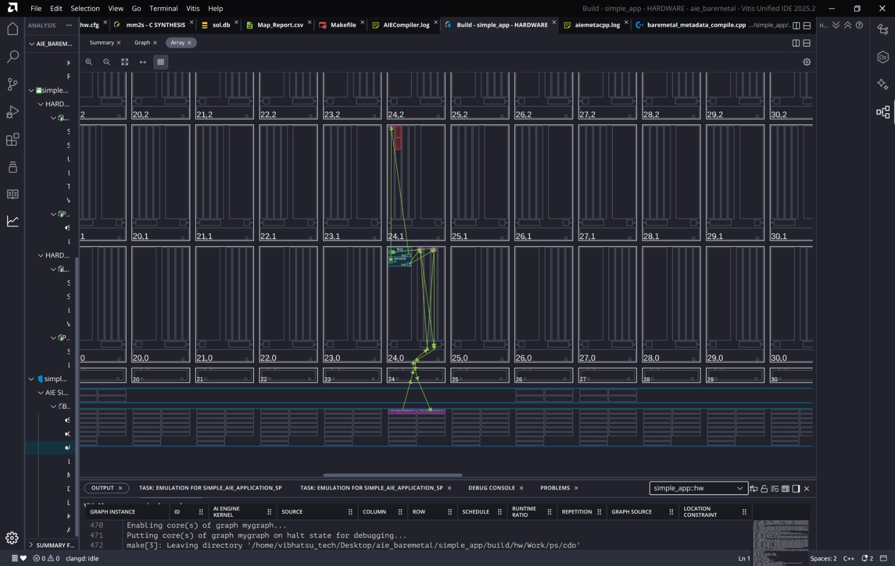
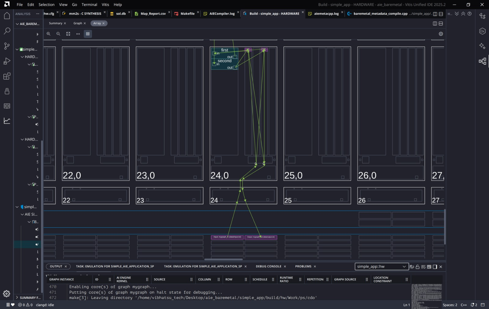
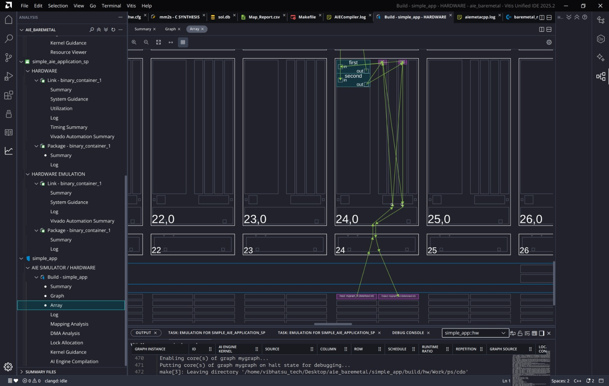
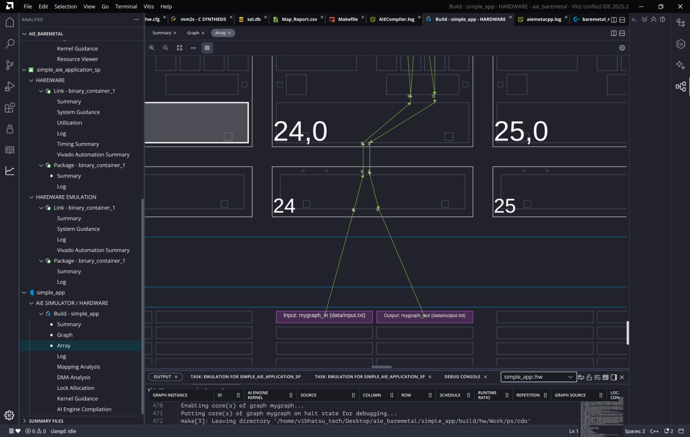
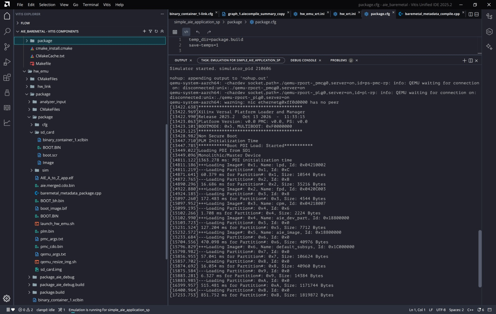

# 09. Results and Discussion

Each result below follows the same pattern: **what we see**, **what it means**, **why it matters**.

---

## 1. AI Engine compile summary

**What we see**
- Status **Completed**, compiler release 2025.2, device `xcvc1902-vsva2197-2MP-e-S`, AI Engine frequency **1250 MHz**, compilation completed 1 of 1.
- Resource utilization:

| Line | Value | Meaning |
|---|---|---|
| Tiles for kernels/buffers/nets | 2 of 400 (0.50 %) | Tiles touched by the design in any way |
| Tiles for AI Engine kernels | 1 of 400 (0.25 %) | Cores that run code |
| Tiles for buffers | 2 of 400 (0.50 %) | Tiles whose memory holds data buffers |
| Tiles for stream interconnect | 2 of 450 (0.44 %) | Stream switches used (450 = 400 tiles + 50 shim tiles) |
| GMIO input / output | 0 of 32 | No memory-mapped AI Engine I/O |
| PLIO input | 1 of 312 (0.32 %) | One stream into the array |
| PLIO output | 1 of 234 (0.43 %) | One stream out of the array |
| DMA FIFO buffers | 0 | No extra FIFO insertion needed |
| Interface channels for ADF input/output | 2 (PLIO: 2) | One in, one out |
| Interface channels for trace | 0 | Trace not enabled |

**What it means**
Two kernels fit on one core, their data needs two tiles of memory, and the stream network needs two switches. The design is tiny on purpose.

**Why it matters**
This is the first check after compiling: does the design fit, and how much headroom is left? Here more than 99 % of the array is free, so the same structure can be replicated or extended. Real designs (beamformers, filters, ML layers) use tens to hundreds of tiles.

---

## 2. Array view: where the design landed

**What we see**
The full 50 x 8 array. Almost everything is empty. One thin green path rises from the bottom edge near **column 24** and touches a handful of tiles.

**What it means**
The compiler placed the whole design in one narrow column area, close to the shim tile it uses for I/O.

**Why it matters**
Placement near the shim keeps routes short, which keeps latency low and leaves the rest of the array free.

Zoomed in: tiles are labelled `column,row`. Row 0 is the bottom compute row next to the shim row. The path runs from the shim at column 24 up through tile (24,0) and reaches a neighbouring tile above it.

**What we see**
Inside the core area of tile (24,0) are two boxes: **`first`** and **`second`**, each with an `in` and an `out` port. Green arrows join them and go to the small markers that represent buffers and DMA channels.

**What it means**
Both kernels are mapped onto the same core, which agrees with "tiles for AI Engine kernels: 1 of 400" in the summary. Arrows show data movement: stream in, buffer, kernel, buffer, stream out.

The left tree lists every report for the system: AI Engine compile reports (Summary, Graph, Array, Log, Mapping Analysis, DMA Analysis, Lock Allocation, Kernel Guidance, AI Engine Compilation) and the system reports (see section 4).

**What we see**
At the bottom, two pink boxes on the shim row: **`Input: mygraph_in (data/input.txt)`** and **`Output: mygraph_out (data/output.txt)`**. Lines connect them up through the tile-24 stream switch into tile (24,0). Small numbers on the lines are stream channel numbers.

**What it means**
Pink means a PLIO port that is in use (unused ports are grey). The input line goes up into the array, the output line comes back down.

**Why it matters**
This is how you trace the full data path: PLIO in -> stream switch -> tile memory -> kernel `first` -> kernel `second` -> tile memory -> stream switch -> PLIO out.

---

## 3. Other AI Engine reports

| Report | What it shows | What to look for |
|---|---|---|
| **Summary** | Build info, utilization | Fit, frequency, build time |
| **Graph** | Kernels, buffers, ports, nets as a diagram plus tables | Connections match your intent |
| **Array** | Physical placement and routes | Compact placement, short routes |
| **Mapping Analysis** | Which resources each block, port and memory bank maps to | Memory bank sharing, port assignment |
| **DMA Analysis** | DMA accesses per tile | Number of channels, possible stalls |
| **Lock Allocation** | Locks assigned to each port | Producer/consumer synchronisation |
| **Kernel Guidance** | Hints for kernel optimisation | Any warnings to act on |
| **Log** | Compiler output | Errors and warnings |

---

## 4. System-level reports (Link and Package)

For both **HARDWARE** and **HARDWARE EMULATION**, under *Link - binary_container_1*:

| Report | Use |
|---|---|
| Summary | Command line and result of the link |
| System Guidance | Suggestions for the whole system |
| Utilization | PL resources used (LUTs, FFs, BRAM, DSP) by `mm2s`, `s2mm` and the platform |
| Timing Summary | Whether the PL meets its clock timing |
| Vivado Automation Summary | What Vivado did automatically |
| Log | Full link log |

Under *Package - binary_container_1*: **Summary** and **Log** describe the boot image that was produced.

---

## 5. Hardware emulation boot log

**What we see**
1. `Simulator started` and QEMU processes waiting for connections on the PMC and PL sockets.
2. A warning that the network device has no peer.
3. The **Xilinx Versal Platform Loader and Manager (PLM)** banner, release 2025.2.
4. `BOOTMODE: 0x5` and `Non Secure Boot`: boot from SD.
5. `Loading PDI from SD1`, then a series of images: `lpd`, `fpd`, `cpm`, `aie_dev_part`, `aie_image`, `default_subsys`. Each has partitions with sizes and load times.
6. A total PDI initialisation time of about 1363 ms.

**What it means**
- The emulated Versal went through its real boot process.
- `aie_dev_part` and `aie_image` are the AI Engine array being configured with our compiled graph.
- `default_subsys` holds the PL design (our linked kernels).
- The no-peer network warning is harmless; no network is used in this design.

**Why it matters**
A clean PDI load proves that the boot image, the platform and the compiled AI Engine configuration are consistent. Only after this does the bare-metal application start.

---

## 6. Output verification
The graph reads `data/input.txt` and writes `data/output.txt` in simulation. The check is to compare the output with the golden file, and in emulation to have the bare-metal application verify what `s2mm` wrote back to DDR. A match confirms the full path DDR -> `mm2s` -> AI Engine -> `s2mm` -> DDR.

---

## 7. Conclusions
- The graph is functionally small but exercises every part of the flow.
- The AI Engine uses 0.5 % of the array, leaving room to scale.
- Placement is compact and the I/O path is clearly visible in the Array view.
- Hardware emulation boots the complete system, which validates the build before moving to a board.
